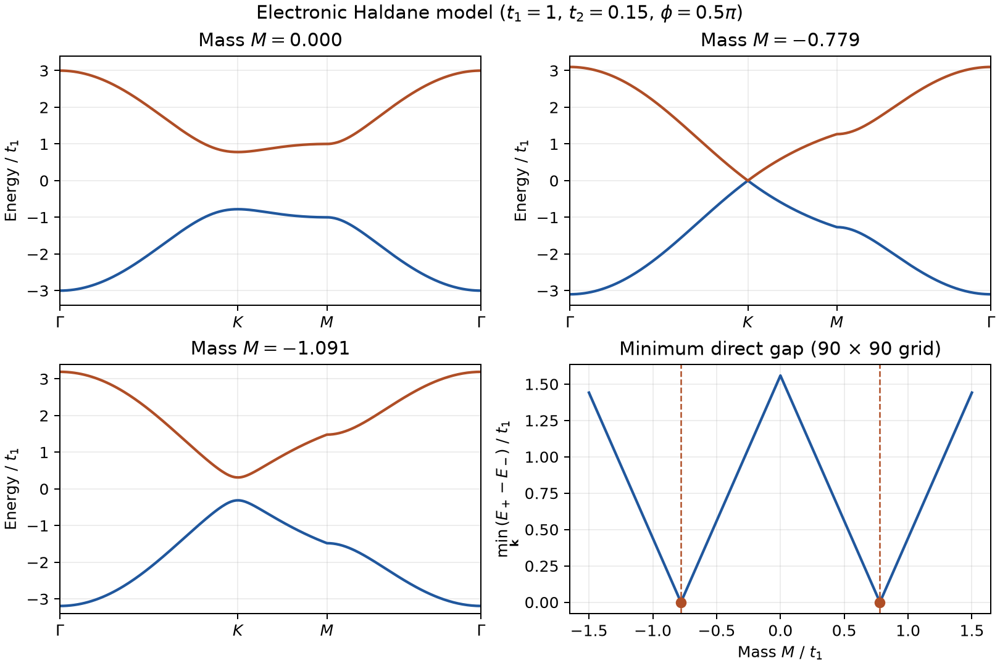
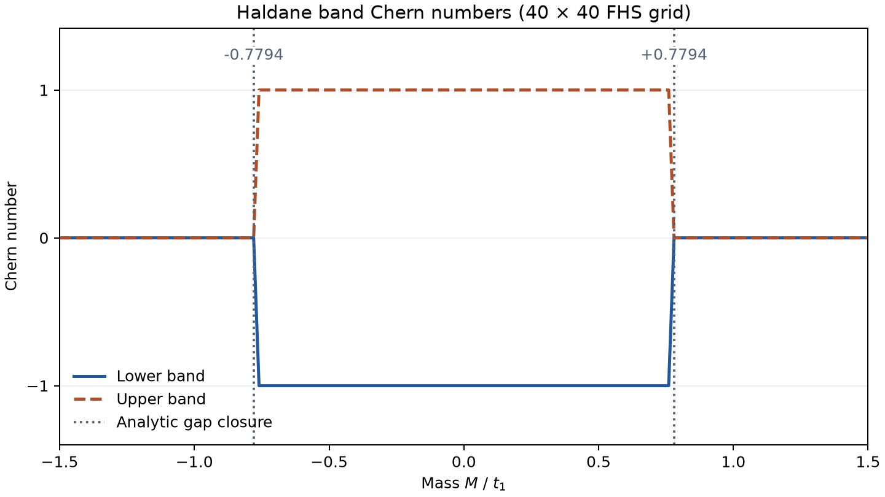
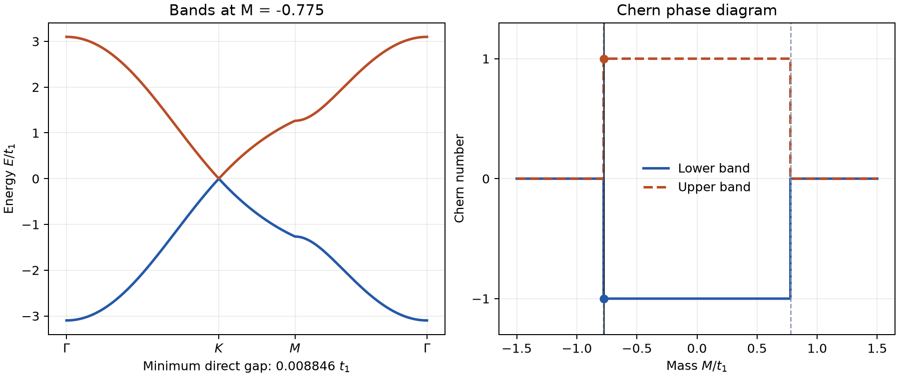
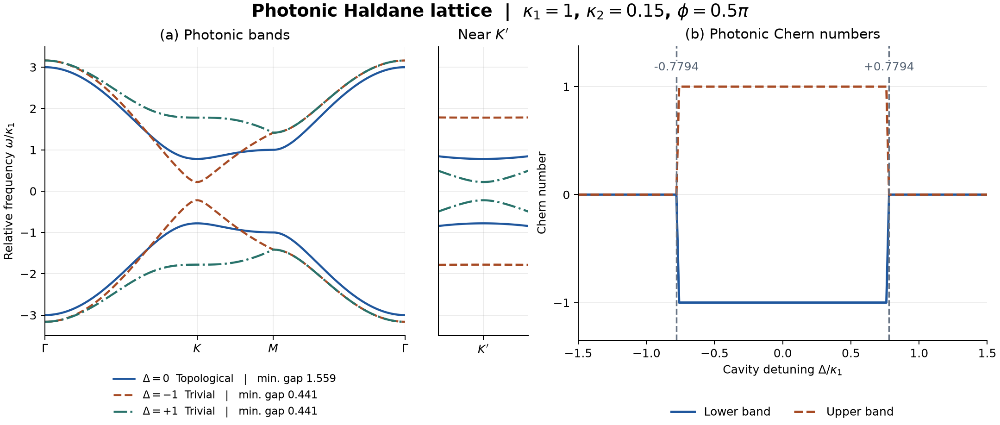
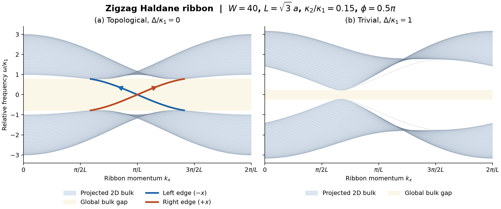
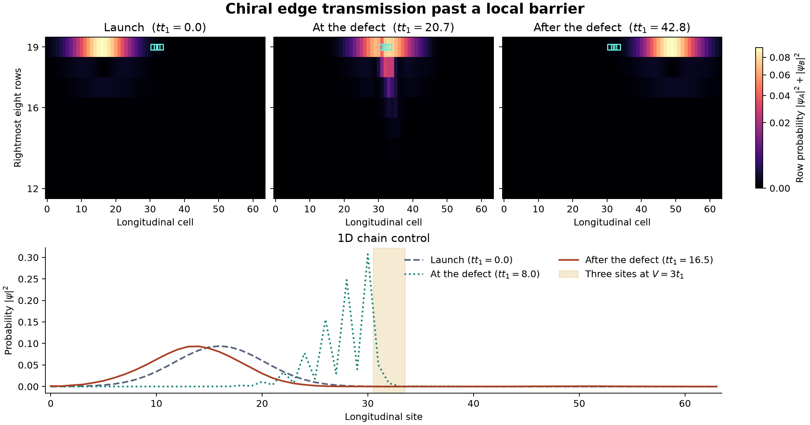
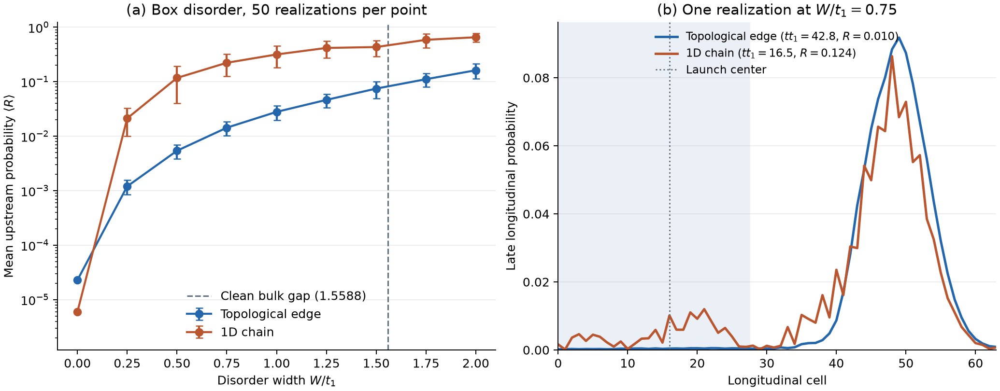

# Haldane 模型的拓扑光子学仿真

> **Abstract.** A from-scratch implementation of the Haldane model as a topological-photonics portfolio project. It computes band structures and Fukui–Hatsugai–Suzuki Chern numbers, resolves chiral edge states on a zigzag ribbon, and quantifies backscattering immunity: a topological edge wave packet transmits **99.84%** past a strong onsite barrier (reflection 0.008%), while a plain 1D waveguide reflects **99.2%** of the same packet, and the protection survives random onsite disorder up to the bulk-gap scale. The electronic tight-binding model is reinterpreted as coupled optical microcavities; every figure is rebuilt with `python reproduce.py`.

先用电子 Haldane 模型验证能带、陈数和体边对应，再把同一套计算映射到耦合微腔，展示光子能带与手性边缘通道。

## 物理背景

### Haldane 模型

蜂窝晶格的最近邻耦合连接 A、B 子晶格，带相位的次近邻耦合打破时间反演对称性。A、B 子晶格的在位项分别为 $+M$ 和 $-M$，与次近邻项竞争，使体能隙在 $|M|=3\sqrt{3}\,|t_2\sin\phi|$ 时闭合并发生拓扑相变。[Haldane，1988](https://doi.org/10.1103/PhysRevLett.61.2015)

### FHS 陈数

FHS 方法在离散布里渊区上构造相邻本征矢的归一化重叠，再对每个小回路的相位求和。实现先把哈密顿量转到倒格周期的子晶格基底，再按周期索引连接网格边界。有限网格上的结果仍接近整数，临界点定位则受网格分辨率限制。[Fukui、Hatsugai、Suzuki，2005](https://arxiv.org/abs/cond-mat/0503172)

### 体边对应

体带陈数决定体隙内每条边界的净手性通道数。这里拓扑相的锯齿条带每侧各有一条跨隙分支，传播方向相反。对于保留体隙且不耦合对侧边缘的局部扰动，同侧缺少可产生弹性背散射的反向通道。[Wang 等，2009](https://dspace.mit.edu/entities/publication/a5ede1be-54b6-404f-9348-20ce134d2de2)

## 结果

### M1 · 电子能带与闭隙

沿 Γ–K–M–Γ 求解两条带，90×90 动量网格验证最小直接能隙在 $M/t_1\approx\pm0.779423$ 降至数值零。



### M2 · 电子陈数

40×40 FHS 网格给出拓扑相下带 $C=-1$、上带 $C=+1$，平庸相两带均为 0。图中灰线为解析闭隙点，离散陈数约在 $M/t_1=\pm0.7768$ 跳变。



### M3 · 交互能带与陈数

在浏览器中打开 [离线交互 HTML](m3_interactive.html)。如果代码托管平台只显示文件内容，下载 HTML 后在本地浏览器打开。拖动滑块可同步查看两幅图，闭隙按钮可直达 K 和 K′ 的临界条件。下图是脚本用同一组数据生成的静态快照。



### M4 · 光子能带与陈数

光子有效模型沿用电子版的无量纲参数。151 个失谐采样点的两条光子带陈数均与 M2 对应点一致。



### M5 · 锯齿条带的手性边缘态

40 单元条带在拓扑相的全局体隙内各有一条局域于左、右边缘的分支，隙中心两支各有约 99.9965% 的概率落在对应边缘的四排单元内。平庸相全局体隙内没有本征态。M4、M5 的频率轴均为 $\omega/\kappa_1$。



### M7 · 缺陷透射

同样的三个 $V=3t_1$ 杂质格点，拓扑边缘波包的透射为 **99.84%**、上游概率为 **0.0076%**，普通一维链的反射则为 **99.22%**。



上图显示 64×20 条带的最外八排，青色方框为右边缘的杂质位置。两组使用相同的高斯宽度和发射位置，各取体隙或能带中点的右行模，并按各自群速度选择包络已经分离的时刻。$R$ 和 $T$ 是杂质缓冲区之外的上游和下游概率，缓冲区内的残余单独计入总概率。此对照在无损紧束缚模型内进行，无吸收和辐射损耗。

### M8 · 无序鲁棒性

去掉单缺陷后，给条带和同长链的每个格点独立加入固定的 $\mathcal U[-W/2,+W/2]$ 在位偏移，每个 $W$ 计算 50 个固定种子的实现。$W/t_1=0.5$ 时，拓扑边缘和链的晚时上游概率分别为 $0.00541\pm0.00153$、$0.11751\pm0.07697$。$W/t_1=2.0$ 时，条带上游概率升至 $0.16228\pm0.04966$。



误差棒为样本标准差。右图对条带概率沿横向求和，阴影为上游读出窗口。全域无序也覆盖注入区，因此这里的 $R$ 是有限时间内留在上游的概率，包含散射与滞留。灰虚线标记干净体隙宽度 $2M_c\approx1.5588t_1$，用来对照无序强度的量级。

## 从源代码重建

在仓库目录用 Python 3.12 安装已验证的依赖版本。

```bash
python -m pip install -r requirements.txt
```

一键重建 M1–M5、M7–M8 的七张 PNG 和 M3 离线 HTML，打印检查结果并运行冒烟测试。

```bash
python reproduce.py
```

也可以按里程碑逐个运行这五条命令。各脚本会把输出写到仓库目录。

```bash
python haldane.py
python m2_chern.py
python m3_interactive.py
python m4_photonic.py
python m5_edge.py
```

用 `python m7_defect.py` 单独重跑缺陷实验并打印 $R$、$T$、残余概率和归一化检查。

用 `python m8_disorder.py` 单独重跑 9 档全域无序扫描，每档打印两组的均值和样本标准差。

单独运行物理冒烟测试用 `python -m unittest -v test_smoke`。四项检查覆盖解析临界质量、陈数整数性和两相的隙内边缘分支数。

## 光子诠释

蜂窝格点的每个格点对应一个微腔模式，具有 Haldane 定向相位的耦合链路给出同一形式的耦合模哈密顿量。旋磁或磁光偏置可以打破时间反演对称性，环形谐振腔链路也可为选定的环行方向提供合成规范相位。[Wang 等，2009](https://dspace.mit.edu/entities/publication/a5ede1be-54b6-404f-9348-20ce134d2de2) · [Hafezi 等，2011](https://arxiv.org/abs/1102.3256)

| 电子 Haldane 模型 | 光子格点 |
| --- | --- |
| 最近邻跃迁 $t_1$ | 相邻微腔的最近邻耦合 $\kappa_1$ |
| 次近邻复跃迁 $t_2 e^{i\phi}$ | 次近邻耦合 $\kappa_2 e^{i\phi}$，反向耦合取复共轭 |
| 在位质量项 $M$ | A、B 微腔的本征角频率分别为 $\omega_0+\Delta$、$\omega_0-\Delta$，有符号频率差为 $2\Delta$ |
| 本征能量 $E$ | 以微腔基准角频率为零点的相对本征角频率 $\omega=\omega_{\mathrm{lab}}-\omega_0$，图中以 $\kappa_1$ 归一化 |

## 模型边界

当前结果来自无损紧束缚有效模型。M5 的色散给出单向通道，M7 量化了特定局部缺陷下的波包反射和透射。实际光子晶体的频谱、散射场分布和损耗需要按具体几何及材料求解 Maxwell 方程，可用平面波展开、FDTD 或 COMSOL。
